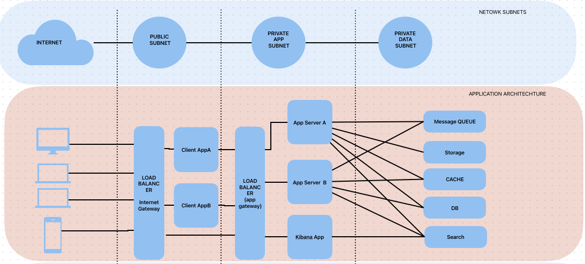

# Multi Tier Web Infrastratucure

## Overview

### Repository Set Up

1. Create Following Children Repos
    - infra
    - client - app
    - backend - mono repo
2. Create Parent Repo, add children repos as submodules

### Appliation Development Enviroment

Appliction Developer(s) make use of local VM or docker containers in order to spin up data services such as databases, search engines and caches

### VPN Application infrastructure

#### Private Data Service Subnet

This subnet host every data service utilized by app servers, only allowing access to the private app subnet

#### Private App Subnet

This subnet host every app server, connects to data services subnet and allows connection from only the client apps

#### Public Subnet

This subnet hosts client apps which are accesible via the internet, can restrict user access based on user identity.

## Objectives

1. **Mono Repo Backend**: Set up Monolithic Backend api app which contains Identification Service, Database for products, along with ability to add caching and search engine optimizations. But simulatanously create it such that we can later on split the monolitch backend into micro services without too much hastle

2. **Client Front End**: Create a next js app which connects to the backend using an api gateway, it must be oblivious wehter the backend is one or many services.

3. **CICD / Devops**: Create Continous Integration and Continous Delivery piplines utlitlzing tools like Ansible for provisioning / IAC, GitHub Actions for automatic testing, building and deployment workflows

## Objective Progress

 Objective  | Status
------------|-------
 1          | Not Started
 2          | Not Started
 3          | Not Started

## Objective 1: Mono Repo Backend

## Objective 2: Client Front End

## Objective 3: CICD/DevOps
